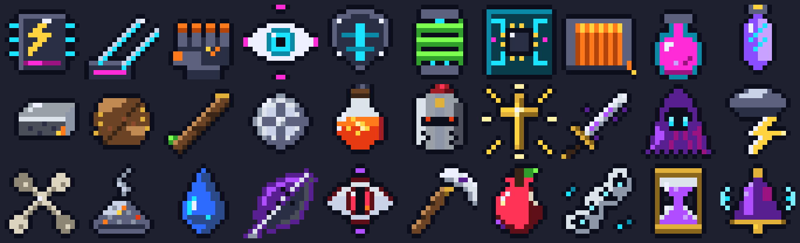
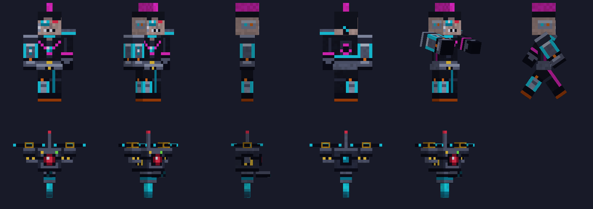

# Книга Судеб — ресурспак

Ресурспак для Minecraft 1.20.1 (`pack_format` 15). Один архив на весь сервер: пластинки героев, ночной город киберпанка и модели его мобов.





## Что внутри

**Пластинки героев** (заменяют звуки ванильных дисков и их названия)

| Диск (ванильный) | Название | Герой |
|---|---|---|
| `music_disc_far` | Тема ослепшего воина | Артист |
| `music_disc_blocks` | Пока горю | Лиза |
| `music_disc_stal` | Вымарано | Даша |
| `music_disc_chirp` | Вяленая баллада | Баблик |
| `music_disc_ward` | Корни в багрянце | Вазелин |
| `music_disc_strad` | Рассвет без красок | Вран |
| `music_disc_mall` | Дом встаёт | Пельмешек |

**Киберпанк** (плагин Kniga 1.9.2 и новее; иконки работают и с 1.9.1). Иконки подменяются по `CustomModelData`, обычные предметы не меняются:

| Предмет | Основа | Номер модели |
|---|---|---|
| Сандевистан | светящийся мешочек чернил | 7101 |
| Клинки богомола | кристаллы призмарина | 7102 |
| Руки гориллы | обломок незерита | 7103 |
| Оптика | око Эндера | 7104 |
| Подкожная броня | железный самородок | 7105 |
| Усилители ног | осколок эха | 7106 |
| Микросхема | повторитель | 7201 |
| Медный провод | медный слиток | 7202 |
| Нейрогель | слизь | 7203 |
| Кристалл-аккумулятор | аметистовый осколок | 7204 |

**Модели мобов киберпанка** (плагин Kniga 1.9.2 и новее). Настоящий моб (зомби или скелет) становится невидимым, а на нём едут части модели: предметы-дисплеи со светящимся мешочком чернил и номером модели. Части качаются в такт шагу, поэтому их несколько:

| Моб | Часть | Номер модели |
|---|---|---|
| Киберпсих | туловище и голова | 7301 |
| Киберпсих | правая рука (кибернетическая) | 7302 |
| Киберпсих | левая рука | 7303 |
| Киберпсих | правая нога (кибернетическая) | 7304 |
| Киберпсих | левая нога | 7305 |
| Дрон-стрелок | корпус | 7401 |
| Дрон-стрелок | винт (одна модель, плагин ставит два) | 7402 |

Без этого пака, но с плагином 1.9.2 игрок увидит вместо мобов висящие мешочки чернил, поэтому пак должен быть обязательным, а плагин и пак обновляются вместе. Выключить модели можно в `config.yml`: `киберпанк.модели: false`.

Звуки (пространство имён `kniga`): `cyber.install`, `cyber.sandevistan_on`, `cyber.sandevistan_off`, `cyber.deposit`, `cyber.complete` и `cyber.ambient` — фоновая музыка города, 64 секунды, петля. Плагин включает их сам, если в `config.yml` стоит `киберпанк.звуки-пака: true` (по умолчанию так).

## Сделать пак обязательным

Нужны три строки в `server.properties` (ссылка и хеш относятся к этой версии архива):

```properties
resource-pack=https://raw.githubusercontent.com/RipMoriarty/Scripts/99c778ec23e375b9cc425a445b702e3a27cf3904/kniga-pack/KnigaPack.zip
resource-pack-sha1=a2848d6cb39ae0f0c11f791200b9c7fafa39e204
require-resource-pack=true
```

Необязательно, но полезно: текст в окне загрузки. Кириллица записана через `\uXXXX`: так текст не превратится в кракозябры, даже если сервер прочтёт файл не как UTF-8:

```properties
resource-pack-prompt={"text":"\u041a\u043d\u0438\u0433\u0430 \u0421\u0443\u0434\u0435\u0431: \u0440\u0435\u0441\u0443\u0440\u0441\u043f\u0430\u043a \u043e\u0431\u044f\u0437\u0430\u0442\u0435\u043b\u0435\u043d (\u043c\u0443\u0437\u044b\u043a\u0430, \u043f\u0440\u0435\u0434\u043c\u0435\u0442\u044b, \u0437\u0432\u0443\u043a\u0438)","color":"gold"}
```

Порядок действий:

1. Остановите сервер. Параметры пака читаются только при запуске.
2. Откройте `server.properties` (в панели хостинга это «Файлы», либо отдельные поля «Resource pack»), впишите строки выше и сохраните.
3. Запустите сервер. Игрок при входе увидит окно с предложением скачать пак. Если нажмёт «Отклонить» или загрузка не удастся, сервер его отключит.
4. Тем, кто уже был на сервере, достаточно зайти заново. Клиент кеширует пак по SHA-1 и скачает его заново только при смене хеша.

Важно:

- Ссылка должна вести прямо на файл (`raw.githubusercontent.com`), а не на страницу GitHub. Ссылка выше привязана к коммиту `99c778e`, поэтому содержимое по ней не изменится, даже если ветку потом обновят.
- `resource-pack-sha1` — 40 символов строчными буквами, без пробелов. Если хеш не совпадёт с файлом, клиент не примет пак.
- Пустой `resource-pack` с `require-resource-pack=true` ничего не требует: сначала должна быть рабочая ссылка.

## Если вы обновили архив

SHA-1 и ссылка меняются с каждым новым файлом:

```bash
sha1sum KnigaPack.zip
```

После коммита возьмите хеш коммита (`git log -1 --format=%H`), подставьте его в ссылку `.../Scripts/<хеш коммита>/kniga-pack/KnigaPack.zip` и впишите новый SHA-1 в `server.properties`. Перезапустите сервер.

## Как собран

`make_cyber_pack.py` берёт прежний архив с пластинками и добавляет иконки, модели и звуки (всё рисуется и синтезируется кодом; нужны Pillow, numpy и ffmpeg с libvorbis). Модели и текстуры мобов рисует `cyber_mobs.py`, он лежит рядом и подключается сам:

```bash
python3 make_cyber_pack.py KnigaPack-heroes.zip KnigaPack.zip
python3 cyber_mobs.py папка_для_превью   # только картинки и таблица точек вращения
```

Результат от запуска к запуску побайтно одинаковый.

## Состав архива

- `pack.mcmeta`, `pack.png`
- `assets/minecraft/sounds/records/*.ogg` — пластинки героев (моно, Vorbis, 44,1 кГц)
- `assets/minecraft/lang/{ru_ru,en_us,uk_ua,be_by}.json` — названия дисков
- `assets/minecraft/models/item/*.json` — модели-основы с подменой по `custom_model_data` (иконки и части мобов)
- `assets/kniga/textures/item/cyber/*.png`, `assets/kniga/models/item/cyber/*.json` — иконки киберпанка
- `assets/kniga/textures/cyber/mob/{psycho,drone}.png`, `assets/kniga/models/cyber/mob/*.json` — текстуры и 7 моделей мобов
- `assets/kniga/sounds.json`, `assets/kniga/sounds/cyber/*.ogg` — звуки и фоновая музыка города
